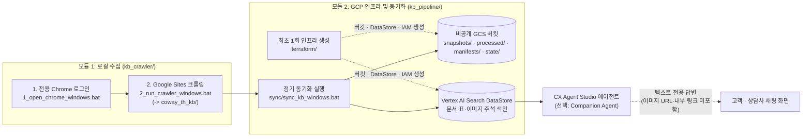

# 비공개 Google Sites 지식베이스 크롤러 및 GCP 검색 파이프라인

사내 Google Workspace 계정 로그인이 필요한 비공개 Google Sites 지식베이스(KB)를 로컬에 수집하고, Google Cloud 리소스(Cloud Storage, Vertex AI Search DataStore) 생성 및 동기화까지 수행하는 저장소입니다.

역할과 실행 환경에 따라 크롤링 모듈(`kb_crawler/`)과 GCP 인프라·동기화 파이프라인 모듈(`kb_pipeline/`) 두 디렉터리로 분리되어 있습니다.

---

## 1. 왜 이 구조로 동작하나요?

1. 사내 인증 통과 (`kb_crawler/`): 사내 SSO 및 2단계 인증이 걸린 비공개 Google Sites와 Google Drive 문서는 외부 클라우드 검색 봇이 직접 접근할 수 없습니다. 열람 권한이 있는 담당자가 로그인한 PC Chrome의 로컬 디버깅 포트(`127.0.0.1:9222`)에 연결해 페이지 본문, 이미지, 첨부 매뉴얼을 로컬로 수집합니다.
2. 이미지·표 내부 글자까지 텍스트로 검색 (`kb_pipeline/sync/`): 수집한 문서를 시맨틱 HTML로 변환하면서 로컬 PNG 및 JPG/JPEG 이미지를 압축 없이 원본 바이트 그대로 Base64 `<figure>`로 포함해 Vertex AI Search(`Layout Parser`, `enable_image_annotation = true`)에 전달합니다. 표 구조는 물론 제품 이미지와 도식 안에 적힌 스펙·안내 문구까지 텍스트 주석으로 추출되어 검색 대상이 됩니다. `.gif` 등 미지원 이미지 형식은 생략해 주변 본문 텍스트를 유지하며, HTML 크기가 `9.5 MB`를 넘을 때는 Base64만 생략하는 안전 폴백을 적용합니다.
3. 이미지 URL을 노출하지 않는 텍스트 전용 응답 (`kb_pipeline/docs/`): 별도의 이미지 프록시 서버나 외부 공개 URL을 두지 않습니다. 비공개 Cloud Storage 버킷은 외부 접근을 차단한 상태로 유지하며, CX Agent Studio 에이전트(및 선택적 Companion Agent)는 검색된 본문, 표, 이미지 주석, 매뉴얼 내용을 텍스트로만 안내하고 이미지 URL, `` 태그, 내부 주소, 매뉴얼 다운로드 링크는 일절 출력하지 않습니다.



---

## 2. 모듈별 가이드 바로가기

| 디렉터리 | 주요 내용 | 상세 가이드 |
| :--- | :--- | :--- |
| [`kb_crawler/`](kb_crawler/README.md) | Chrome 디버깅 포트(CDP)로 비공개 Google Sites 메뉴 계층, 본문 Markdown, 이미지, Google Drive 첨부 문서를 로컬(`kb_crawler/coway_th_kb/`)에 수집하고 권한 리포트(`_drive_files.json`)를 생성합니다. GCP 설정 없이 단독 실행할 수 있습니다. | [크롤러 사용자 가이드](kb_crawler/README.md) |
| [`kb_pipeline/`](kb_pipeline/README.md) | Terraform으로 비공개 GCS 버킷, Vertex AI Search DataStore, 최소 권한 IAM을 생성하고, 수집된 로컬 폴더를 시맨틱 HTML로 변환해 DataStore에 동기화합니다. 텍스트 전용 에이전트 연동 명세를 함께 포함합니다. | [파이프라인 및 GCP 가이드](kb_pipeline/README.md) |

---

## 3. 최초 도입 순서 (팀 간 협업 흐름)

처음 환경을 구축할 때는 3개 담당 역할이 아래 순서로 진행하면 병목 없이 연결됩니다. 정기 운영 단계에서는 2번(크롤링) -> 3번(동기화) 두 단계만 반복합니다.

| 순서 | 작업 | 담당 | 필요한 입력값 | 다음 담당자에게 전달할 값 | 참고 문서 |
| :---: | :--- | :--- | :--- | :--- | :--- |
| 1 | GCP 버킷·DataStore·IAM 생성 (`terraform apply`) | GCP 인프라 담당자 | GCP 프로젝트 ID, CX Agent Studio 앱 리전(`us`/`eu`/`global`), 동기화 담당자 계정(`operator_members`) | `kb_bucket_name`, `datastore_location`, `datastore_id`, `datastore_name` | [Terraform 가이드](kb_pipeline/terraform/README.md) |
| 2 | 전용 Chrome 로그인 및 KB 로컬 크롤링 (1번과 병렬 진행 가능) | KB 수집·동기화 담당자 | Google Sites·Drive 열람 가능 사내 계정 | 로컬 수집 폴더 (`kb_crawler/coway_th_kb/`) | [크롤러 가이드](kb_crawler/README.md) |
| 3 | 최초 DataStore 동기화 실행 | KB 수집·동기화 담당자 | 1·2번 결과값 + `gcloud` 로그인(또는 서비스 계정 키) | 색인 완료된 DataStore | [파이프라인 가이드](kb_pipeline/README.md) |
| 4 | 에이전트 `DataStoreTool` 연결, 텍스트 전용 지시문 적용, 회귀 평가 | 에이전트 담당자 | `datastore_name`, 동기화 완료된 DataStore | 검증 완료된 에이전트 | [에이전트 설정 가이드](kb_pipeline/docs/agent-datastore-instructions.md) |

> 사전 확인 사항 (보안 및 데이터 공개 범위)
> - 고객 노출 범위: DataStore에 적재된 모든 페이지, 첨부 매뉴얼 내용, PNG/JPG 이미지 판독 텍스트는 고객 응대 답변의 근거로 사용될 수 있습니다. 상담사나 내부 직원만 보아야 하는 기밀 자료는 원본 사이트에서 분리해야 합니다.
> - 텍스트 전용 응답 및 비공개 저장소 유지: Cloud Storage 버킷은 외부 공개가 차단(`public_access_prevention = "enforced"`)되어 있으며 별도의 이미지 프록시를 두지 않습니다. 에이전트는 이미지 URL, Markdown 이미지 문법(``), 내부 Google Sites/Drive 주소, 매뉴얼 파일 다운로드 링크를 출력하지 않도록 구성합니다 ([에이전트 설정 가이드](kb_pipeline/docs/agent-datastore-instructions.md) 5~8절 참조).

---

## 4. 주요 설정값 이름 대조표

문서와 실행 도구마다 부르는 이름이 다른 동일 설정값의 대응표입니다.

| 항목 | Terraform 변수 / 출력 | `sync_kb_windows.bat` | `sync_kb.py` CLI 옵션 | 에이전트 설정 / 비고 |
| :--- | :--- | :--- | :--- | :--- |
| 비공개 GCS 버킷 이름 | `kb_bucket_name` | `KB_BUCKET_DEFAULT` | `--bucket` | DataStore 가져오기 원본 버킷 (외부 비공개) |
| DataStore 리전 | `datastore_location` | `KB_DATASTORE_LOCATION_DEFAULT` | `--datastore-location` | CX Agent Studio 앱 리전과 동일 |
| DataStore ID / 전체 경로 | `datastore_id` / `datastore_name` | `KB_DATASTORE_ID_DEFAULT` | `--datastore-id` | CX Agent Studio `DataStoreTool` 연결 대상 |
| 로컬 크롤링 결과 폴더 | (해당 없음) | `KB_SOURCE_DEFAULT` (자동 탐색) | `--source-dir` | 기본값 `kb_crawler/coway_th_kb` |

---

## 5. 저장소 디렉터리 구조

```text
.
├── README.md                          # 저장소 전체 개요 및 모듈 연결 허브 (본 문서)
├── kb_crawler/                        # [모듈 1] 비공개 Google Sites 로컬 크롤러
│   ├── README.md                      # 크롤러 단독 실행 및 운영 가이드
│   ├── 1_open_chrome_windows.bat      # [1/2] 크롤링 전용 디버깅 Chrome 실행
│   ├── 2_run_crawler_windows.bat      # [2/2] 가상환경 구성 및 로컬 크롤링 실행
│   ├── crawl_sites.py                 # CDP 기반 크롤러 메인 스크립트
│   └── requirements.txt               # 크롤러 전용 패키지 (websockets)
├── kb_pipeline/                       # [모듈 2] GCP 리소스 생성 및 Vertex AI Search 동기화
│   ├── README.md                      # GCP 인프라 및 DataStore 동기화 가이드
│   ├── CONTRACT.md                    # 버킷·HTML 변환·차단기·IAM 연동 규격서
│   ├── terraform/                     # GCP 버킷, DataStore, 최소 권한 IAM 선언 코드
│   ├── sync/                          # HTML 변환(html_render.py) 및 동기화 실행(sync_kb.py, sync_kb_windows.bat)
│   └── docs/                          # 에이전트 DataStoreTool 설정 및 텍스트 전용 지시문 가이드
└── tests/                             # 크롤러 및 동기화 파이프라인 단위 테스트
```

---

## 6. 단위 테스트 실행 (개발자용)

저장소 루트에서 가상환경을 구성해 두 모듈(`kb_crawler/`, `kb_pipeline/`)의 단위 테스트를 검증할 수 있습니다.

```bash
python3 -m venv .venv
.venv/bin/pip install pytest websockets
.venv/bin/pytest
```
