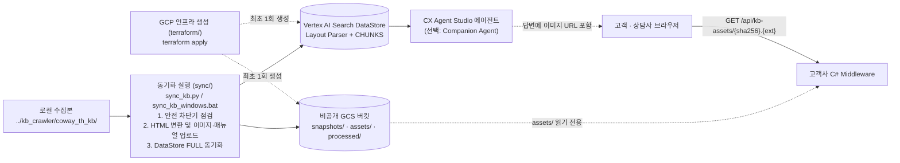

# GCP 인프라 생성 및 지식베이스 동기화 파이프라인 가이드 (`kb_pipeline/`)

[kb_crawler/](../kb_crawler/README.md)가 로컬에 수집한 지식베이스(`coway_th_kb/` 내 Markdown, 이미지, Drive 첨부 문서)를 Google Cloud에 적재하기 위한 **GCP 리소스 생성(`terraform/`)**, **동기화 스크립트(`sync/`)**, **미들웨어·에이전트 연동 명세(`docs/`, `CONTRACT.md`)**를 담은 모듈입니다.

복잡한 별도 서버 없이 비공개 Cloud Storage 버킷, Vertex AI Search DataStore, 운영 PC 동기화 스크립트 하나로 표·이미지·첨부 매뉴얼까지 검색 색인을 최신 상태로 유지합니다.

---

## 1. 동작 원리 및 하위 구성

동기화 스크립트(`sync_kb.py`)를 실행하면 아래 3단계가 순서대로 일어납니다.

1. **안전 차단기 점검 (Circuit Breaker)**: 아래 3단계의 전체 동기화(`FULL` 모드)는 이번 목록에 없는 구버전 문서를 검색 색인에서 자동 삭제합니다. 만약 크롤링 오류로 일부 페이지만 수집된 상태에서 동기화가 실행되면 정상 문서까지 지워질 수 있으므로, 직전 성공 대비 페이지 수가 80% 미만으로 급감했거나 홈 페이지·매뉴얼이 비정상 누락된 경우 업로드를 사전에 차단합니다.
2. **HTML 인라인 이미지 변환 및 버킷 업로드**: Vertex AI Search의 문서 파서(`Layout Parser`)는 외부 이미지 링크를 따라가지 않고 HTML 문서 안에 직접 포함된 이미지(Base64)만 읽어 표와 글자를 추출합니다. 반면 에이전트는 검색된 본문 텍스트만 볼 수 있으므로, 각 이미지 옆에 고정 중계 주소(``)를 함께 적고 원본 이미지는 비공개 버킷 `assets/`에 저장합니다.
3. **Vertex AI Search 전체 동기화 (`FULL` 모드)**: 변경되지 않은 문서는 해시가 동일해 재처리 비용 없이 건너뛰고, 새로 추가·수정된 페이지와 Drive 매뉴얼(`pdf`, `docx`, `pptx`, `xlsx`, `xlsm`)만 반영하며 사이트에서 내려간 문서는 색인에서 제거합니다.



| 경로 | 대상 독자 | 설명 |
| :--- | :--- | :--- |
| [terraform/](terraform/README.md) | GCP 인프라 담당자 | 비공개 GCS 버킷, Vertex AI Search DataStore, 최소 권한 IAM 최초 1회 배포 |
| `sync/` | KB 동기화 운영자 | 로컬 안전 차단기, HTML 변환(`html_render.py`), DataStore 동기화(`sync_kb.py`, `sync_kb_windows.bat`) |
| [CONTRACT.md](CONTRACT.md) | 전체 엔지니어 | 핵심 용어(`Knowledge Page`, `Manual Document`, `Visual Reference`), 버킷 구조, 변환·보안 계약 |
| [docs/middleware-kb-assets-spec.md](docs/middleware-kb-assets-spec.md) | C# 미들웨어 개발자 | `GET /api/kb-assets/{sha256}.{ext}` 이미지 중계 API 규격 및 .NET 8 참조 구현 |
| [docs/agent-datastore-instructions.md](docs/agent-datastore-instructions.md) | 에이전트 구성 담당자 | `DataStoreTool` 연결 방법, 에이전트 지시문 프롬프트, 스모크 검증 및 `E1`~`E11` 회귀 평가 |

---

## 2. 1단계: GCP 리소스 생성 (`terraform/`, 최초 1회)

인프라 담당자가 [terraform/README.md](terraform/README.md) 절차에 따라 비공개 버킷, Vertex AI Search DataStore, IAM 권한을 생성합니다.

```bash
cd kb_pipeline/terraform
cp terraform.tfvars.example terraform.tfvars
# terraform.tfvars에 project_id, kb_bucket_name, datastore_location, operator_members 등 입력
terraform init
terraform apply
```

- `datastore_location`(`us`, `eu`, `global`)은 연결할 CX Agent Studio 앱 리전과 반드시 일치해야 합니다.
- 배포 완료 후 출력되는 `kb_bucket_name`, `datastore_location`, `datastore_id`를 동기화 운영 담당자에게 전달합니다.

---

## 3. 2단계: 로컬 수집본 GCS 및 DataStore 동기화 (`sync/`)

[kb_crawler/](../kb_crawler/README.md) 실행으로 `kb_crawler/coway_th_kb/` 폴더가 준비된 상태에서 실행합니다.

### 사전 인증 준비 (운영 PC 최초 1회)

동기화 스크립트가 Google Cloud API를 호출할 수 있도록 아래 두 가지 방법 중 하나로 자격증명(ADC, Application Default Credentials)을 준비합니다.

- **대화형 수동 실행 시**: 운영 PC에 [Google Cloud SDK(`gcloud`)](https://cloud.google.com/sdk/docs/install)를 설치하고 `operator_members`에 등록된 계정으로 아래 명령을 1회 실행해 로그인합니다.
  ```bash
  gcloud auth application-default login
  ```
- **무인 스케줄러 운영 시**: `operator_members`에 등록된 서비스 계정의 키 JSON 파일 경로를 `sync_kb_windows.bat`의 `KB_KEY_FILE_DEFAULT`(또는 `GOOGLE_APPLICATION_CREDENTIALS` 환경변수)에 지정합니다.

### 방법 A. Windows 배치 파일로 실행 (`sync\sync_kb_windows.bat`, 권장)

1. 최초 1회 `kb_pipeline\sync\sync_kb_windows.bat`을 메모장으로 열어 상단 기본값을 확인·입력하고 저장합니다.

   | 배치 변수명 | 필수 여부 | 입력할 값 |
   | :--- | :---: | :--- |
   | `KB_PROJECT_DEFAULT` | 필수 | GCP 프로젝트 ID |
   | `KB_BUCKET_DEFAULT` | 필수 | Terraform 출력 `kb_bucket_name` |
   | `KB_ASSET_BASE_URL_DEFAULT` | 필수 | C# 미들웨어 이미지 기본 URL (예: `https://mw.example.com/api/kb-assets`, 끝 `/` 제외). **첫 동기화 시점에는 주소만 확정되어 있으면 되며, 미들웨어 코드가 아직 배포되기 전이어도 동기화는 정상 완료됩니다** (단, 나중에 호스트 주소를 바꾸면 재동기화가 필요합니다). |
   | `KB_DATASTORE_LOCATION_DEFAULT` | 필수 | Terraform 출력 `datastore_location` (`us`, `eu`, `global` 중 하나, 기본 `us`) |
   | `KB_DATASTORE_ID_DEFAULT` | 필수 | Terraform 출력 `datastore_id` (기본 `coway-kb`) |
   | `KB_ROOT_PAGE_URL_DEFAULT` | 필수 | 안전 차단기 점검용 홈 URL (기본값: 태국 콜센터 KB 홈. 다른 사이트 수집 시 변경하며, 배치 파일 안에서는 `%`를 `%%` 두 개로 표기) |
   | `KB_SOURCE_DEFAULT` | 선택 | 비워 두면 `..\..\kb_crawler\coway_th_kb` 경로를 자동 탐색 |
   | `KB_KEY_FILE_DEFAULT` | 선택 | 서비스 계정 키 JSON 경로 (`gcloud` 로그인 대신 키 파일을 쓸 때만 입력) |

2. `kb_pipeline\sync\sync_kb_windows.bat`을 더블클릭합니다.
3. 최초 실행 시 `kb_pipeline\sync\.venv` 가상환경을 자동 생성하고 필수 패키지(`google-cloud-storage`, `google-cloud-discoveryengine`, `pillow`)를 설치한 뒤 동기화를 수행합니다.
4. `[성공] 페이지 N건 / 매뉴얼 M건 반영` 메시지(종료 코드 `0`)가 출력되면 반영이 완료된 것입니다.

### 방법 B. 터미널 CLI로 직접 실행

`kb_pipeline` 패키지를 인식할 수 있도록 **저장소 루트 폴더**에서 실행합니다.

```bash
cd /path/to/kb-crawler
python3 -m venv kb_pipeline/sync/.venv
kb_pipeline/sync/.venv/bin/pip install -r kb_pipeline/sync/requirements.txt

kb_pipeline/sync/.venv/bin/python -m kb_pipeline.sync.sync_kb \
  --source-dir ./kb_crawler/coway_th_kb \
  --bucket <KB_BUCKET> \
  --project <PROJECT_ID> \
  --datastore-location us \
  --datastore-id coway-kb \
  --asset-base-url https://<middleware-host>/api/kb-assets
```

### 주요 CLI 옵션 및 종료 코드

| 옵션 | 기본값 | 설명 |
| :--- | :--- | :--- |
| `--source-dir` | (필수) | 크롤링 결과 로컬 폴더 경로 (예: `./kb_crawler/coway_th_kb`) |
| `--bucket` | (필수) | 비공개 KB Cloud Storage 버킷 이름 |
| `--project` | (필수) | GCP 프로젝트 ID |
| `--datastore-location` | `us` | DataStore 리전 (`us`, `eu`, `global`) |
| `--datastore-id` | `coway-kb` | Vertex AI Search DataStore ID |
| `--asset-base-url` | (필수) | C# 미들웨어 이미지 중계 기본 URL (`https://<host>/api/kb-assets`) |
| `--root-page-url` | 태국 콜센터 KB 홈 URL | 안전 차단기가 검사할 홈 페이지 원본 URL (인코딩·비인코딩 모두 허용) |
| `--min-page-ratio` | `0.8` | 직전 성공 대비 최소 페이지 유지 비율 (80% 미만 감소 시 차단) |
| `--force-sync` | 꺼짐 | 의도된 대규모 페이지·매뉴얼 삭제 시 안전 차단기를 건너뛰고 강제 반영 |
| `--import-timeout-seconds` | `3600` | Vertex AI Search 색인 작업 완료 대기 제한 시간(초) |

| 종료 코드 | 출력 접두어 | 의미 |
| :---: | :--- | :--- |
| `0` | `[성공] 페이지 N건 / 매뉴얼 M건 반영` | 스냅샷 업로드, DataStore 반영(`SUCCEEDED`), `state/last_success.json` 갱신 완료 |
| `1` | `[실패] ...` | 가져오기 또는 API 오류 (`state/last_success.json` 유지) |
| `2` | `[차단됨] ...` | 안전 차단기 작동(페이지 20% 이상 급감, 홈 누락, 매뉴얼 0건). 정상 변경이면 `--force-sync`로 재실행 |
| `4` | `[오류] ...` | 로컬 폴더 누락 또는 필수 인자 오류 (표준 CLI 파서 종료 코드 `2`와 차단기 코드 충돌을 피하기 위해 `4` 사용) |
| `5` | `[로그인 필요] ...` | GCP 자격증명(ADC) 만료 또는 미설정 |
| `130` | `[중단] ...` | 사용자가 `Ctrl+C`로 실행을 중단함 |

---

## 4. Windows 작업 스케줄러 연속 자동화 (크롤링 + 동기화)

[kb_crawler/README.md](../kb_crawler/README.md) 6절의 작업 스케줄러 등록 시, 동작 탭의 인수에 크롤러 배치 파일과 동기화 배치 파일을 `&&`로 연결하면 크롤링이 성공했을 때만 이어서 DataStore 동기화가 자동 실행됩니다.

- 프로그램/스크립트: `cmd.exe`
- 인수 추가:
  `/c "set KB_UNATTENDED=1 && C:\kb\kb_crawler\2_run_crawler_windows.bat && C:\kb\kb_pipeline\sync\sync_kb_windows.bat"`
- 시작 위치: `C:\kb`

---

## 5. 동기화 문제 해결 (Troubleshooting)

### `[차단됨] 동기화를 차단했습니다. 페이지 수가 직전 성공 ...건에서 ...건으로 줄었습니다` (종료 코드 `2`)
- 원인: 크롤링 도중 일부 메뉴 로딩 실패로 수집 페이지 수가 직전 성공 대비 80% 미만으로 줄었거나, Drive 권한 만료로 매뉴얼 파일이 0건으로 떨어졌거나, 실제 사이트에서 대량의 구버전 페이지를 정리한 경우입니다.
- 해결: 먼저 `kb_crawler/coway_th_kb/_manifest.json`과 `_drive_files.json`을 확인해 비정상 누락인지 점검합니다. 실제 사이트 개편에 따른 정상 삭제라면 아래처럼 `--force-sync` 옵션을 붙여 1회 실행합니다.
  ```cmd
  kb_pipeline\sync\sync_kb_windows.bat --force-sync
  ```

### `[로그인 필요] Google 로그인 정보(ADC)가 없습니다` (종료 코드 `5`)
- 원인: GCP Application Default Credentials가 없거나 만료되었습니다.
- 해결: 터미널에서 `gcloud auth application-default login`을 실행해 재인증하거나, `sync_kb_windows.bat`의 `KB_KEY_FILE_DEFAULT`에 유효한 서비스 계정 키 JSON 파일 경로를 설정하세요.
