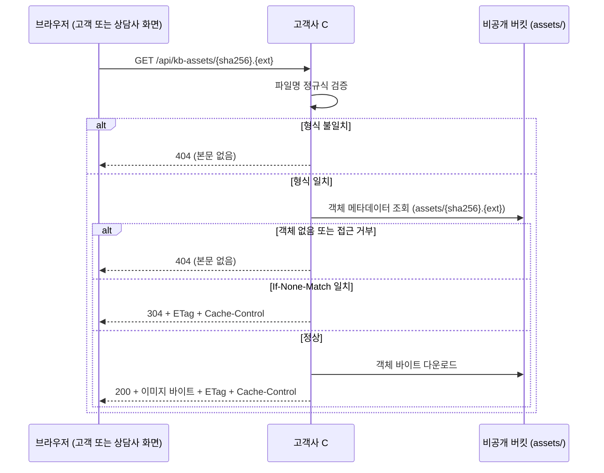

# 고객사 C# Middleware 지식베이스 이미지 중계 엔드포인트 명세서 (`GET /api/kb-assets/{sha256}.{ext}`)

본 문서는 고객사 C# (.NET) 미들웨어에 추가할 이미지 중계 엔드포인트 한 개의 규격을 정의합니다. 에이전트 답변에 포함된 `Visual Reference` 이미지를 고객 화면과 상담사 화면에 안전하게 표시하기 위한 연동 명세입니다.

> 문서 범위 및 기준 안내
> - 대상 구간: `브라우저(고객 채팅 화면, 상담사 화면) -> 고객사 C# Middleware -> 비공개 Cloud Storage 버킷`
> - 포함 기능: 이미지 한 건 조회(`GET`, `HEAD`), 조건부 요청(`If-None-Match`), 장기 캐시 헤더
> - 제외 기능: `Manual Document` 원본 파일 제공, 버킷 목록 조회, 업로드, 이미지 변환(리사이즈 등)
> - 기준 문서: [CONTRACT.md](../CONTRACT.md)의 "이미지 서빙 규격 (C# 미들웨어)" 절
> - 적용 안내: 7절의 .NET 8 참조 구현 적용 후 9절의 테스트 항목으로 동작을 검증합니다.

---

## 1. 배경과 전체 흐름

지식베이스 파이프라인은 지식 웹사이트 본문의 이미지를 내용 해시(SHA-256) 이름으로 비공개 버킷의 `assets/` 아래에 저장하고, 검색 문서 본문에는 아래 형태의 Markdown 이미지 태그를 넣습니다.

```text

```

CX Agent Studio 에이전트(`Agent Session`)와 Companion Agent(`Assist Session`)는 이 태그를 답변에 그대로 옮기고, 화면이 Markdown을 렌더링하면서 브라우저가 미들웨어 URL로 이미지를 요청합니다. 버킷은 비공개이므로 미들웨어가 자신의 Google 자격증명으로 객체를 읽어 바이트를 그대로 돌려줍니다.



### 1.1 URL이 고정되는 시점

이미지 URL의 앞부분(`https://<미들웨어 호스트>/api/kb-assets`)은 파이프라인 설정값 `ASSET_BASE_URL`이며, 전처리 때 검색 문서 본문에 그대로 기록됩니다. 따라서 다음 두 가지를 지켜야 합니다.

- 첫 파이프라인 실행 전에 운영 호스트명과 경로를 확정해 파이프라인 담당자에게 전달합니다. 값 끝에 `/`를 붙이지 않습니다.
- 호스트명이나 경로를 바꾸면 이미 색인된 문서의 이미지가 모두 깨집니다. 변경할 때는 파이프라인을 새 값으로 다시 실행해 색인을 갱신하고, 갱신이 끝날 때까지 이전 URL도 계속 응답하도록 유지합니다.

---

## 2. 요청 규격

| 항목 | 규격 |
| :--- | :--- |
| 메서드 | `GET` (필수), `HEAD` (권장). 그 외 메서드는 `405 Method Not Allowed` |
| 경로 | `/api/kb-assets/{sha256}.{ext}` |
| `{sha256}` | 객체 바이트의 SHA-256 해시. 소문자 16진수 64자 |
| `{ext}` | `png`, `jpg`, `webp`, `gif`, `svg` 중 하나. 소문자, 점 없음. `jpeg`는 파이프라인이 `jpg`로 통일해 저장하므로 허용하지 않습니다. |
| 쿼리 문자열 | 사용하지 않습니다. 붙어 있어도 무시하며, 버킷이나 경로를 쿼리로 받지 않습니다. |
| 요청 본문 | 없음 |
| 호출자 인증 | 없음 (2.2절 참조) |

### 2.1 파일명 검증

경로의 마지막 구간 전체가 아래 정규식과 일치할 때만 버킷을 조회합니다. 일치하지 않으면 버킷에 접근하지 않고 바로 `404`를 반환합니다.

```text
^[0-9a-f]{64}\.(png|jpg|webp|gif|svg)$
```

구현 시 유의사항은 다음과 같습니다.

- .NET 정규식의 `$`는 문자열 끝의 줄바꿈 문자 앞에서도 일치합니다. 샘플 코드처럼 끝 앵커를 `\z`로 쓰십시오.
- 대소문자를 구분합니다. 대문자 16진수(`3F2A...`)나 대문자 확장자(`.PNG`)는 거절합니다. `RegexOptions.IgnoreCase`를 쓰지 않습니다.
- 입력을 소문자로 바꾸거나 잘라내는 등 보정하지 않습니다. 형식이 다르면 거절합니다.
- 객체 이름은 항상 코드에 고정된 접두사 `assets/`와 검증을 통과한 파일명을 이어 붙여 만듭니다. 요청에서 받은 값으로 접두사나 버킷을 바꿀 수 있는 경로를 두지 않습니다.

### 2.2 호출자 인증을 두지 않는 이유

이 엔드포인트는 고객 채팅 화면의 `` 요청을 직접 받습니다. 고객 브라우저는 미들웨어 로그인 세션이나 토큰을 갖고 있지 않으므로 호출자 인증을 요구하면 이미지가 표시되지 않습니다. 접근 통제는 다음 세 가지로 이루어집니다.

- URL에 포함된 256비트 해시는 추측할 수 없습니다. URL을 아는 사람만 해당 이미지 한 건을 볼 수 있습니다.
- 목록 조회 기능이 없으므로 URL 하나를 알아도 다른 이미지를 찾을 수 없습니다.
- 제공 대상이 `assets/` 아래의 이미지로 한정됩니다(6절).

> 고객사 확인 필요: 호출자 인증 없이 여는 방식은 고객사 보안 담당자의 확인을 받기 전의 설계안입니다. 확인 결과에 따라 이 절이 바뀔 수 있습니다.
>
> 전제: `Knowledge Base`는 고객 응대와 상담사 보조가 함께 쓰는 저장소이므로, 지식 웹사이트 본문의 모든 이미지는 고객에게 표시될 수 있는 자료로 취급됩니다. 고객에게 보여서는 안 되는 이미지가 원본 사이트에 있다면 이 엔드포인트가 아니라 원본 사이트에서 분리해야 합니다. 이 판단은 고객사 지식 관리 담당자와 확인이 필요합니다.

---

## 3. Cloud Storage 객체 읽기

### 3.1 자격증명과 권한

미들웨어가 이미 사용하고 있는 서비스 계정의 Application Default Credentials를 `GoogleCredential.GetApplicationDefault()`로 읽고, 스코프는 `https://www.googleapis.com/auth/cloud-platform`으로 통일합니다. 이 엔드포인트를 위해 별도 서비스 계정이나 키 파일을 추가로 만들지 않습니다.

권한은 파이프라인 Terraform이 부여합니다. 미들웨어 서비스 계정의 이메일을 파이프라인 담당자에게 전달하면, 담당자가 Terraform 변수 `middleware_members`에 `serviceAccount:<이메일>` 형식으로 등록합니다. 등록된 계정은 지식베이스 버킷에서 이름이 `assets/`로 시작하는 객체만 읽을 수 있습니다.

| 항목 | 값 |
| :--- | :--- |
| NuGet 패키지 | `Google.Cloud.Storage.V1` (`Google.Apis.Auth` 포함) |
| 자격증명 | 기존 미들웨어 서비스 계정 (Application Default Credentials) |
| 버킷 권한 | 지식베이스 버킷의 `assets/` 접두사에 대한 객체 읽기 전용. 파이프라인 Terraform의 `middleware_members`로 부여합니다. ([terraform/README.md](../terraform/README.md) 참조) |
| 필요한 작업 | 객체 메타데이터 조회와 객체 다운로드 (`storage.objects.get`). 목록 조회, 버킷 메타데이터 조회, 쓰기, 삭제 권한은 없으며 호출하지도 않습니다. 객체는 정확한 이름으로만 읽습니다. |
| 설정값 | 버킷 이름 1개 (예: `KbAssets:BucketName`, Terraform 출력 `kb_bucket_name`). 접두사 `assets/`는 설정이 아니라 코드 상수로 둡니다. |

`StorageClient`는 요청마다 만들지 말고 DI 컨테이너에 Singleton으로 등록해 재사용합니다.

### 3.2 객체 이름과 내용

- 객체 이름: `assets/{sha256}.{ext}` (요청 파일명과 동일)
- 객체는 내용 해시로 이름이 정해지므로 한 번 쓰이면 내용이 바뀌지 않습니다. 같은 이름이면 항상 같은 바이트입니다.
- 미들웨어는 바이트를 변형하지 않고 그대로 전달합니다. 리사이즈, 재인코딩, 워터마크를 적용하지 않습니다.

### 3.3 Cloud Storage 오류 해석

| Cloud Storage 응답 | 의미 | 클라이언트 응답 |
| :--- | :--- | :--- |
| `404 Not Found` | 객체 없음 | `404` |
| `403 Forbidden` | 객체가 없거나 권한이 없음. 호출자에게 버킷 목록 권한이 없으면 Cloud Storage는 없는 객체에 대해서도 `403`을 반환합니다. | `404` (내부 로그에는 경고로 기록) |
| `401`, `429`, `5xx`, 타임아웃 | 자격증명 또는 일시 장애 | `503` |

`403`이 계속 기록되면 서비스 계정 권한 설정이 빠진 것일 수 있으므로 내부 로그에서 구분해 확인할 수 있게 합니다.

---

## 4. 응답 규격

### 4.1 상태 코드

| 상태 | 조건 | 본문 | `Cache-Control` |
| :--- | :--- | :--- | :--- |
| `200 OK` | 객체를 정상 조회 | 이미지 바이트 (`HEAD`는 본문 없음) | `public, max-age=31536000, immutable` |
| `304 Not Modified` | 객체가 존재하고 `If-None-Match`가 ETag와 일치 | 없음 | `public, max-age=31536000, immutable` |
| `404 Not Found` | 파일명 형식 불일치, 객체 없음, 접근 거부 | 없음 | `no-store` |
| `405 Method Not Allowed` | `GET`, `HEAD` 이외의 메서드 | 없음 | `no-store` |
| `503 Service Unavailable` | Cloud Storage 장애, 자격증명 오류, 타임아웃 | 없음 | `no-store` |

### 4.2 확장자별 `Content-Type`

`Content-Type`은 객체에 저장된 메타데이터가 아니라 요청 확장자로 결정합니다.

| 확장자 | `Content-Type` |
| :--- | :--- |
| `png` | `image/png` |
| `jpg` | `image/jpeg` |
| `webp` | `image/webp` |
| `gif` | `image/gif` |
| `svg` | `image/svg+xml` |

### 4.3 응답 헤더

| 헤더 | 값 | 적용 대상 | 설명 |
| :--- | :--- | :--- | :--- |
| `Content-Type` | 4.2절 표 | `200` | |
| `Content-Length` | 객체 크기 | `200` | 메타데이터의 크기 값을 사용합니다. |
| `Cache-Control` | `public, max-age=31536000, immutable` | `200`, `304` | 계약에 고정된 값입니다. 값을 줄이거나 `private`으로 바꾸지 않습니다. |
| `ETag` | `"{sha256}"` | `200`, `304` | 큰따옴표를 포함한 강한 ETag. 파일명의 해시를 그대로 씁니다. |
| `X-Content-Type-Options` | `nosniff` | 전체 | 브라우저가 내용을 다른 형식으로 추측하지 못하게 합니다. |
| `Content-Security-Policy` | `default-src 'none'; style-src 'unsafe-inline'; sandbox` | `svg`의 `200` | SVG 파일을 주소창에서 직접 열었을 때 내부 스크립트가 실행되지 않게 합니다. `` 표시에는 영향을 주지 않습니다. |

`Cache-Control: immutable`이 안전한 이유는 URL이 내용 해시이기 때문입니다. 원본 사이트에서 이미지가 교체되면 해시가 달라져 새 URL이 만들어지므로, 기존 URL의 응답을 1년간 재검증 없이 캐시해도 오래된 이미지가 표시되지 않습니다.

`404`와 `503`에는 `Cache-Control: no-store`를 붙여 브라우저나 중간 프록시가 오류 응답을 장기 캐시하지 않게 합니다.

### 4.4 ETag와 조건부 요청

- ETag 값은 `"{sha256}"`입니다. Cloud Storage가 주는 ETag나 generation 값을 쓰지 않습니다. 미들웨어 인스턴스가 여러 대여도 값이 같습니다.
- `If-None-Match` 헤더에 이 ETag(또는 `*`)가 포함되어 있고 객체가 존재하면 `304`를 본문 없이 반환합니다. 약한 비교를 적용하므로 `W/"{sha256}"`도 일치로 봅니다.
- 객체 존재 확인(메타데이터 조회)을 먼저 하고 `304`를 판단합니다. 존재하지 않는 해시에 `If-None-Match`를 붙여 보낸 요청에는 `404`를 반환합니다.
- `If-Modified-Since`는 지원하지 않습니다. `Last-Modified` 헤더도 보내지 않습니다.
- `Range` 요청은 지원하지 않습니다. `Range` 헤더가 있어도 무시하고 전체 본문을 `200`으로 반환합니다.

`immutable` 지시어를 지원하는 브라우저는 유효기간 안에 재검증 요청을 보내지 않으므로 조건부 요청은 드물게 발생합니다.

---

## 5. 오류 응답에서 지켜야 할 것

오류 응답은 버킷에 대한 정보를 전혀 드러내지 않아야 합니다.

- 형식이 잘못된 요청, 존재하지 않는 객체, 권한이 없는 객체에 대해 상태 코드, 헤더, 본문이 모두 같은 `404`를 반환합니다. 응답만 보고 세 경우를 구분할 수 없어야 합니다.
- 오류 본문은 비워 둡니다. 버킷 이름, 객체 경로, `gs://` 주소, Cloud Storage 오류 메시지, 예외 메시지, 스택 트레이스를 넣지 않습니다. 프레임워크의 개발자 예외 페이지가 이 경로에 적용되지 않는지 확인합니다.
- Cloud Storage 응답 헤더(`x-goog-*`, `x-guploader-uploadid` 등)를 클라이언트에 전달하지 않습니다. 응답 헤더는 4.3절의 값만 미들웨어가 직접 구성합니다.
- Cloud Storage 주소로 리다이렉트(`302`)하지 않습니다.
- 상세 원인은 미들웨어 내부 로그에만 남깁니다. 로그에는 요청 해시, 상태 코드, Cloud Storage 상태 코드를 기록합니다.
- 본문 전송 도중 Cloud Storage 오류가 나면 이미 `200` 헤더가 나간 상태이므로 상태를 바꿀 수 없습니다. 연결을 끊어 브라우저가 불완전한 이미지를 캐시하지 않게 합니다.

---

## 6. 미들웨어가 하지 말아야 할 것

- `Manual Document` 원본 파일(`pdf`, `docx`, `pptx`, `xlsx`, `xlsm`)을 어떤 경로로도 제공하지 않습니다. 매뉴얼은 내용만 답변 근거로 쓰이며, 파일 다운로드 링크는 고객과 상담사 모두에게 제공하지 않는 것이 설계 결정입니다. 허용 확장자 목록에 문서 형식을 추가하지 않습니다.
- `assets/` 밖의 객체를 제공하지 않습니다. 같은 버킷의 `snapshots/`, `processed/`, `manifests/`, `state/`에는 원본 수집본과 매뉴얼 파일, 내부 사이트 주소가 들어 있습니다.
- 버킷 이름, 접두사, 객체 경로를 요청 파라미터로 받지 않습니다.
- 객체 목록을 반환하는 엔드포인트를 만들지 않습니다.
- Signed URL을 발급하거나 Cloud Storage 주소로 리다이렉트하지 않습니다(8절).
- 버킷에 쓰거나 삭제하지 않습니다. 버킷 내용은 파이프라인만 변경합니다.
- 이미지 바이트를 변형하지 않습니다.

---

## 7. C# (.NET 8) 구현 예제

필요 NuGet 패키지: `Google.Cloud.Storage.V1`

ASP.NET Core Minimal API 기준 참조 구현입니다. 미들웨어의 기존 Google Cloud 클라이언트와 동일한 자격증명 방식을 사용합니다.

```csharp
using System;
using System.Collections.Generic;
using System.Net;
using System.Text.RegularExpressions;
using System.Threading;
using System.Threading.Tasks;
using Google;
using Google.Apis.Auth.OAuth2;
using Google.Cloud.Storage.V1;
using Microsoft.AspNetCore.Builder;
using Microsoft.AspNetCore.Http;
using Microsoft.AspNetCore.Routing;
using Microsoft.Extensions.Logging;
using Microsoft.Net.Http.Headers;
using StorageObject = Google.Apis.Storage.v1.Data.Object;

namespace Coway.Middleware.Gecx;

public sealed partial class KbAssetProxy
{
    // 접두사는 설정이 아닌 상수: assets/ 밖의 객체는 어떤 경우에도 읽지 않음
    private const string AssetPrefix = "assets/";
    private const string ImmutableCacheControl = "public, max-age=31536000, immutable";
    private const string SvgContentSecurityPolicy =
        "default-src 'none'; style-src 'unsafe-inline'; sandbox";

    private static readonly string[] Scopes = ["https://www.googleapis.com/auth/cloud-platform"];

    private static readonly IReadOnlyDictionary<string, string> ContentTypes =
        new Dictionary<string, string>(StringComparer.Ordinal)
        {
            ["png"] = "image/png",
            ["jpg"] = "image/jpeg",
            ["webp"] = "image/webp",
            ["gif"] = "image/gif",
            ["svg"] = "image/svg+xml"
        };

    private readonly StorageClient _storage;
    private readonly string _bucketName;
    private readonly ILogger<KbAssetProxy> _logger;

    public KbAssetProxy(string bucketName, ILogger<KbAssetProxy> logger)
    {
        _bucketName = bucketName;
        _logger = logger;
        // 기존 CxasSseClient와 동일한 Application Default Credentials 사용
        GoogleCredential credential = GoogleCredential.GetApplicationDefault().CreateScoped(Scopes);
        _storage = StorageClient.Create(credential);
    }

    // 끝 앵커는 \z 사용: $는 문자열 끝 줄바꿈 앞에서도 일치함
    [GeneratedRegex(@"^(?<hash>[0-9a-f]{64})\.(?<ext>png|jpg|webp|gif|svg)\z", RegexOptions.CultureInvariant)]
    private static partial Regex AssetFileNamePattern();

    public async Task HandleAsync(HttpContext http, string fileName)
    {
        CancellationToken ct = http.RequestAborted;
        HttpResponse response = http.Response;
        response.Headers[HeaderNames.XContentTypeOptions] = "nosniff";

        // 1. 파일명 검증: 불일치 시 버킷에 접근하지 않고 404
        Match match = AssetFileNamePattern().Match(fileName);
        if (!match.Success)
        {
            WriteEmpty(response, StatusCodes.Status404NotFound);
            return;
        }

        string hash = match.Groups["hash"].Value;
        string ext = match.Groups["ext"].Value;
        string objectName = AssetPrefix + fileName;
        string etag = $"\"{hash}\"";

        // 2. 객체 메타데이터 조회 (존재 확인 + 크기)
        StorageObject obj;
        try
        {
            obj = await _storage.GetObjectAsync(_bucketName, objectName, cancellationToken: ct);
        }
        catch (GoogleApiException ex) when (ex.HttpStatusCode == HttpStatusCode.NotFound)
        {
            WriteEmpty(response, StatusCodes.Status404NotFound);
            return;
        }
        catch (GoogleApiException ex) when (ex.HttpStatusCode == HttpStatusCode.Forbidden)
        {
            // 목록 권한이 없으면 없는 객체도 403으로 응답됨. 클라이언트에는 404로 통일
            _logger.LogWarning("KB asset forbidden: hash={Hash}", hash);
            WriteEmpty(response, StatusCodes.Status404NotFound);
            return;
        }
        catch (Exception ex) when (ex is not OperationCanceledException)
        {
            // 원인은 내부 로그에만 기록하고 응답에는 싣지 않음
            _logger.LogError(ex, "KB asset metadata read failed: hash={Hash}", hash);
            WriteEmpty(response, StatusCodes.Status503ServiceUnavailable);
            return;
        }

        response.Headers[HeaderNames.ETag] = etag;
        response.Headers[HeaderNames.CacheControl] = ImmutableCacheControl;

        // 3. 조건부 요청: If-None-Match가 일치하면 본문 없이 304
        if (IfNoneMatchMatches(http.Request, etag))
        {
            response.StatusCode = StatusCodes.Status304NotModified;
            return;
        }

        // 4. 정상 응답 헤더 구성: Content-Type은 확장자로 결정
        response.StatusCode = StatusCodes.Status200OK;
        response.ContentType = ContentTypes[ext];
        if (obj.Size is ulong size)
        {
            response.ContentLength = (long)size;
        }
        if (ext == "svg")
        {
            response.Headers[HeaderNames.ContentSecurityPolicy] = SvgContentSecurityPolicy;
        }

        if (HttpMethods.IsHead(http.Request.Method))
        {
            return;
        }

        // 5. 바이트를 변형 없이 응답 스트림으로 전달
        try
        {
            await _storage.DownloadObjectAsync(obj, response.Body, cancellationToken: ct);
        }
        catch (Exception ex) when (ex is not OperationCanceledException)
        {
            // 이미 200 헤더가 전송된 상태이므로 연결을 끊어 불완전한 본문이 캐시되지 않게 함
            _logger.LogError(ex, "KB asset download failed: hash={Hash}", hash);
            http.Abort();
        }
    }

    private static bool IfNoneMatchMatches(HttpRequest request, string etag)
    {
        var expected = new EntityTagHeaderValue(etag);
        foreach (EntityTagHeaderValue candidate in request.GetTypedHeaders().IfNoneMatch)
        {
            if (candidate.Equals(EntityTagHeaderValue.Any) ||
                candidate.Compare(expected, useStrongComparison: false))
            {
                return true;
            }
        }
        return false;
    }

    private static void WriteEmpty(HttpResponse response, int statusCode)
    {
        response.StatusCode = statusCode;
        response.Headers[HeaderNames.CacheControl] = "no-store";
        response.ContentLength = 0;
    }
}

public static class KbAssetEndpointExtensions
{
    /// <summary>
    /// GET, HEAD /api/kb-assets/{fileName} 등록. 그 외 메서드는 라우팅이 405로 응답
    /// </summary>
    public static IEndpointRouteBuilder MapKbAssets(this IEndpointRouteBuilder endpoints)
    {
        endpoints
            .MapMethods(
                "/api/kb-assets/{fileName}",
                [HttpMethods.Get, HttpMethods.Head],
                (HttpContext http, string fileName, KbAssetProxy proxy) => proxy.HandleAsync(http, fileName))
            .AllowAnonymous();
        return endpoints;
    }
}
```

`Program.cs` 등록 예시:

```csharp
builder.Services.AddSingleton(sp => new KbAssetProxy(
    builder.Configuration["KbAssets:BucketName"]!,
    sp.GetRequiredService<ILogger<KbAssetProxy>>()));

WebApplication app = builder.Build();
app.MapKbAssets();
```

구현 메모:

- 미들웨어 전역에 인증 정책이 걸려 있으면 이 경로만 익명 접근을 허용해야 합니다(`AllowAnonymous`). 반대로 이 경로 외의 API가 함께 익명으로 열리지 않는지 확인합니다.
- 경로 템플릿의 `{fileName}`은 `/`를 포함하지 않는 한 구간만 받습니다. 하위 경로를 모두 받는 `{*path}` 형태를 쓰지 않습니다.
- 앞단에 리버스 프록시나 CDN이 있으면 `Cache-Control`과 `ETag`를 덮어쓰거나 제거하지 않는지 확인합니다. CDN을 두면 미들웨어와 Cloud Storage 호출이 줄어들며, URL이 내용 해시이므로 캐시 무효화가 필요 없습니다.
- 전역 예외 처리기가 이 경로의 오류 응답에 본문을 채우지 않도록 합니다.

---

## 8. Signed URL이 아니라 고정 중계 URL을 쓰는 이유

대안별 제약과 고정 중계 URL 채택 사유는 다음과 같습니다.

| 방식 | 문제 |
| :--- | :--- |
| 검색 문서 본문에 Cloud Storage V4 Signed URL을 직접 기록 | V4 Signed URL의 최대 유효기간은 7일입니다. 지식베이스는 주간 또는 월간으로 갱신되므로 다음 갱신 전에 URL이 만료되어 이미지가 깨집니다. |
| 응답 시점에 미들웨어가 답변 텍스트 속 URL을 Signed URL로 치환 | 답변은 SSE와 gRPC 스트림으로 조각 단위로 도착합니다. URL 문자열이 조각 경계에 걸리면 버퍼링과 재조립 로직이 필요해지고, 두 에이전트의 스트림 양쪽에 같은 처리를 넣어야 합니다. |
| 버킷 공개 | 같은 버킷에 원본 수집본과 매뉴얼 파일이 함께 있어 허용할 수 없습니다. |
| 고정 중계 URL (채택) | 검색 문서에 기록된 URL이 만료되지 않습니다. 미들웨어는 답변 텍스트를 수정하지 않고 그대로 전달하면 됩니다. URL이 내용 해시이므로 장기 캐시가 가능하고, 버킷은 비공개로 유지됩니다. |

---

## 9. 테스트 방법

### 9.1 테스트용 URL 구하기

동기화 스크립트(`sync_kb.py`)가 종료 코드 `0`(`[성공]` 출력)으로 한 번 완료된 뒤 동기화 담당자에게 실제 이미지 URL 몇 개를 받습니다. 담당자는 버킷의 `assets/` 아래 객체 이름으로 URL을 만들 수 있습니다. 확장자별로 하나씩(`png`, `jpg`, `webp`, `gif`, `svg` 중 버킷에 존재하는 것) 준비하면 좋습니다.

아래 예시에서 `$BASE`는 `https://<미들웨어 호스트>/api/kb-assets`, `$HASH`는 실제 객체의 64자 해시입니다.

### 9.2 확인 항목

| 번호 | 요청 | 기대 결과 |
| :---: | :--- | :--- |
| 1 | `GET $BASE/$HASH.png` | `200`, `Content-Type: image/png`, `Cache-Control: public, max-age=31536000, immutable`, `ETag: "$HASH"`, `X-Content-Type-Options: nosniff` |
| 2 | 1번 응답 본문의 SHA-256 계산 | 계산값이 `$HASH`와 일치 (바이트를 변형하지 않았다는 확인) |
| 3 | `GET` + `If-None-Match: "$HASH"` | `304`, 본문 없음, `ETag`와 `Cache-Control` 포함 |
| 4 | `GET` + `If-None-Match: "0000"` | `200`, 전체 본문 |
| 5 | `HEAD $BASE/$HASH.png` | `200`, 본문 없음, `Content-Length`가 1번과 동일 |
| 6 | 존재하지 않는 해시 (64자 `0`) | `404`, 본문 없음, `Cache-Control: no-store` |
| 7 | 대문자 16진수 해시 | `404` (6번과 응답이 동일) |
| 8 | 63자 또는 65자 해시 | `404` |
| 9 | 실제 해시에 다른 확장자 (`$HASH.pdf`, `$HASH.jpeg`, `$HASH.PNG`) | `404` |
| 10 | 실제 해시에 허용되지만 틀린 확장자 (`png` 객체를 `$HASH.jpg`로 요청) | `404` (객체 이름이 다르므로 존재하지 않음) |
| 11 | 경로 조작 (`$BASE/..%2Fstate%2Flast_success.json`, `$BASE/assets/$HASH.png`, `$BASE/$HASH.png%0A`) | `404` |
| 12 | `POST`, `PUT`, `DELETE` | `405` |
| 13 | `svg` 객체 `GET` | `200`, `Content-Type: image/svg+xml`, `Content-Security-Policy` 포함 |
| 14 | 6~11번 응답의 헤더와 본문 비교 | 서로 구분되지 않음. 버킷 이름, `gs://`, `x-goog-` 헤더, 예외 메시지가 없음 |
| 15 | 미들웨어의 Google 자격증명을 일시적으로 무효화한 상태에서 1번 요청 (개발 환경) | `503`, 본문 없음, 내부 로그에만 원인 기록 |

### 9.3 `curl` 예시

```bash
BASE="https://<미들웨어 호스트>/api/kb-assets"
HASH="<실제 객체의 64자 해시>"

# 1. 정상 조회: 상태와 헤더 확인
curl -sS -D - -o /dev/null "$BASE/$HASH.png"

# 2. 무결성 확인: 출력된 해시가 $HASH와 같아야 함
curl -sS "$BASE/$HASH.png" | sha256sum

# 3. 조건부 요청: 304 기대
curl -sS -D - -o /dev/null -H "If-None-Match: \"$HASH\"" "$BASE/$HASH.png"

# 6. 존재하지 않는 객체: 404, 본문 0바이트 기대
curl -sS -D - "$BASE/0000000000000000000000000000000000000000000000000000000000000000.png"

# 9. 허용되지 않는 확장자: 404 기대
curl -sS -D - -o /dev/null "$BASE/$HASH.pdf"

# 12. 허용되지 않는 메서드: 405 기대
curl -sS -D - -o /dev/null -X POST "$BASE/$HASH.png"
```

Windows에서는 `sha256sum` 대신 PowerShell의 `Get-FileHash -Algorithm SHA256 <저장한 파일>`을 사용합니다. 출력이 대문자이므로 비교할 때 대소문자를 무시합니다.

### 9.4 단위 테스트 권장 항목

파일명 검증 함수는 Cloud Storage 없이 테스트할 수 있습니다. 최소한 아래 입력을 포함합니다.

| 입력 | 기대 |
| :--- | :---: |
| 소문자 16진수 64자 + `.png`, `.jpg`, `.webp`, `.gif`, `.svg` | 허용 |
| 대문자가 섞인 해시 | 거절 |
| 63자, 65자 해시 | 거절 |
| `.jpeg`, `.PNG`, `.pdf`, `.xlsx`, 확장자 없음 | 거절 |
| 끝에 줄바꿈(`\n`)이 붙은 정상 파일명 | 거절 |
| 앞뒤 공백, `/` 또는 `..` 포함 | 거절 |

### 9.5 화면 연동 확인

엔드포인트가 정상이어도 화면이 Markdown 이미지 태그를 렌더링하지 않으면 이미지가 보이지 않습니다. 에이전트 답변 텍스트에 ``가 포함된 실제 대화로 고객 화면과 상담사 화면을 각각 확인합니다. 답변이 스트림 조각으로 도착하므로 이미지 태그가 조각 경계에서 잘린 상태로 렌더링되지 않도록, 조각을 누적한 텍스트를 기준으로 렌더링해야 합니다.

---

## 10. 공식 문서 출처

| 구분 | 문서 제목 | 공식 URL |
| :--- | :--- | :--- |
| Cloud Storage .NET SDK | `Google.Cloud.Storage.V1` .NET Client Library Reference (`StorageClient`) | https://cloud.google.com/dotnet/docs/reference/Google.Cloud.Storage.V1/latest |
| Signed URL | Signed URLs (V4 서명 최대 유효기간 7일) | https://cloud.google.com/storage/docs/access-control/signed-urls |
| HTTP 캐시 | RFC 8246: HTTP Immutable Responses | https://www.rfc-editor.org/rfc/rfc8246 |
| 조건부 요청 | RFC 9110: HTTP Semantics (`ETag`, `If-None-Match`) | https://www.rfc-editor.org/rfc/rfc9110 |
